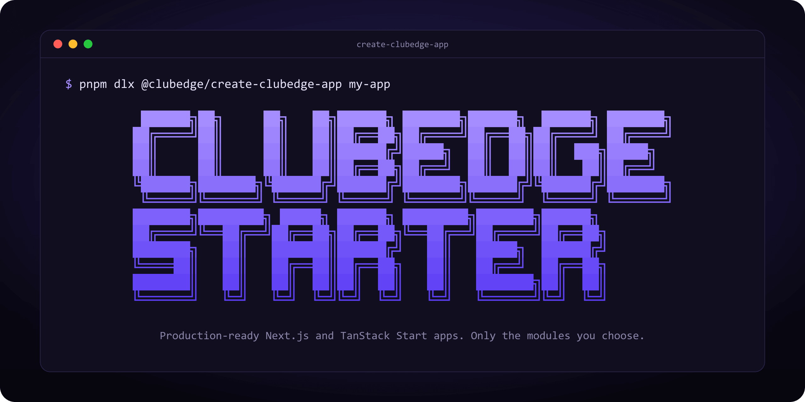

<!-- clubedge:if starter-repository -->
<div align="center">



# Clubedge Starter

**A production-ready full-stack TypeScript starter that ships only the modules you choose.**

Next.js or TanStack Start on PostgreSQL, with optional auth, storage, email, payments,<br>
background jobs, observability, and deployment, each behind an interface you can replace.

[](https://github.com/Clubedge/clubedge-starter/actions/workflows/ci.yml)
[](https://github.com/Clubedge/clubedge-starter/actions/workflows/starter.yml)
[](https://github.com/Clubedge/clubedge-starter/releases)
[](https://www.npmjs.com/package/@clubedge/create-clubedge-app)
[](LICENSE)

[Website](https://starter.clubedge.live) ·
[Create a project](https://github.com/Clubedge/create-clubedge-app) ·
[Setup guide](SETUP.md) ·
[Roadmap](ROADMAP.md) ·
[Releases](https://github.com/Clubedge/clubedge-starter/releases)

</div>

```sh
pnpm dlx @clubedge/create-clubedge-app my-app
```

## Why Clubedge Starter

Most starters give you one stack and leave you to rip out what you don't need. Removing a provider means hunting down its package, its environment variables, its docs, and its lockfile entries, and once you have changed the code, a newer version of the starter is something you can only copy from by hand.

Clubedge Starter is built the other way around. Every service is an optional module, and a module you leave out is removed completely. Each provider sits behind an interface in its own package, so you can swap Supabase Auth for Better Auth, or OpenTelemetry for Sentry, without touching your pages. And because [create-clubedge-app](https://github.com/Clubedge/create-clubedge-app) records exactly what your project was generated from, it can add, remove, or upgrade modules later by merging the change into your code, keeping your edits.

Every combination in the CI matrix is generated as a real project and runs its full pipeline: install, lint, typecheck, unit tests, browser tests against real local services, a production build, and a smoke test.

<!-- In generated projects, the block below supplies the title that create-clubedge-app replaces with the project's name; its comment keeps it hidden here. -->
<!-- clubedge:end -->
<!-- clubedge:if framework=next|tanstack-start
# Clubedge Starter
<!-- clubedge:end -->

## Features

**Application**

- Next.js App Router with React, TypeScript, Tailwind CSS 4, and shadcn/ui using Base UI primitives. <!-- clubedge:only framework=next -->
- TanStack Start with React, TypeScript, Vite, Tailwind CSS 4, and shadcn/ui using Base UI primitives. <!-- clubedge:only framework=tanstack-start -->
- pnpm workspaces and Turborepo, with the web app in `apps/web` and framework-agnostic packages under `packages/`.
- Drizzle ORM and PostgreSQL schema, migrations, and seed commands.
- Zod environment validation, security headers, structured errors, and `/api/health`.
- A landing page and a working dashboard built from the shared UI package.

**Modules**

- Supabase Auth with server-verified sessions in secure cookies, a protected dashboard, and rate-limited sign-in. <!-- clubedge:only auth=supabase -->
- Better Auth with users and sessions in your own PostgreSQL, secure session cookies, a protected dashboard, and rate-limited sign-in. <!-- clubedge:only auth=better-auth -->
- Firebase Authentication through the app's own pages, with server-side session cookies, a protected dashboard, and rate-limited sign-in; the Auth Emulator in development. <!-- clubedge:only auth=firebase -->
- Appwrite accounts through the app's own pages, on Appwrite Cloud or your own server, with server-side session cookies, a protected dashboard, and rate-limited sign-in. <!-- clubedge:only auth=appwrite -->
- Password reset by email, and email verification that can be required before sign-in. <!-- clubedge:only auth=better-auth && email!=none -->
- Password reset by email, sent by Supabase. <!-- clubedge:only auth=supabase -->
- An account settings page: display name, password change, and account deletion. <!-- clubedge:only auth!=none -->
- Email over SMTP, for any provider or a local inbox; development prints emails to the server log until SMTP is configured. <!-- clubedge:only email=smtp -->
- Email through Resend; development prints emails to the server log until the API key is set. <!-- clubedge:only email=resend -->
- S3-compatible storage adapter for AWS S3, Cloudflare R2, and MinIO. <!-- clubedge:only storage=s3 -->
- Supabase Storage adapter that uses the signed-in user's session. <!-- clubedge:only storage=supabase -->
- Fixed-window rate limiter and cache on Redis, falling back to process memory without `REDIS_URL`. <!-- clubedge:only cache=redis -->
- Fixed-window rate limiter and cache in process memory, suited to a single server instance. <!-- clubedge:only cache=memory -->
- Subscriptions with Stripe Checkout and the customer portal, kept in sync by verified webhooks, behind a provider-neutral payments interface. <!-- clubedge:only payments=stripe -->
- Background jobs with retries and schedules, stored in PostgreSQL by pg-boss and run by a worker inside the app server, behind a provider-neutral jobs interface. <!-- clubedge:only jobs=pg-boss -->
- Background jobs with retries and schedules, stored in Redis by BullMQ and run by a worker inside the app server, behind a provider-neutral jobs interface. <!-- clubedge:only jobs=bullmq -->
- Background jobs with retries and schedules, run by Inngest, which calls the app for each one, behind a provider-neutral jobs interface. <!-- clubedge:only jobs=inngest -->
- Server error reporting and request tracing with OpenTelemetry, to any OTLP collector, behind a provider-neutral observability interface. <!-- clubedge:only observability=otel -->
- Server error reporting and request tracing with Sentry, behind a provider-neutral observability interface. <!-- clubedge:only observability=sentry -->

**Production**

- A production image that includes its own migrator (`node /app/migrate.mjs`), for running migrations before each release.
- A manual deploy workflow for the chosen platform, and a readiness endpoint (`/api/ready`) that checks the database.
- Deployment to Fly.io with `fly.toml`: migrations run as the release command. <!-- clubedge:only deploy=fly -->
- Deployment to Railway with `.railway/railway.ts`: migrations run before each release, and `pnpm clubedge deploy` sets up the project. <!-- clubedge:only deploy=railway -->
- Deployment to Render with a `render.yaml` Blueprint: migrations run before each deploy. <!-- clubedge:only deploy=render -->
- Deployment to Vercel with `apps/web/vercel.json`: the build stops when a production variable is missing, then runs migrations. <!-- clubedge:only deploy=vercel -->
- Deployment to Netlify with `apps/web/netlify.toml`: the build stops when a production variable is missing, then runs migrations. <!-- clubedge:only deploy=netlify -->

**Quality**

- GitHub Actions CI with Vitest, Playwright, ESLint, and Prettier.
- `pnpm check:services`, which proves the app can reach every configured service with a real round trip.

<!-- clubedge:if starter-repository -->

## Modules

Pick modules when you create a project, and change them later with `pnpm clubedge add` and `pnpm clubedge remove`.

| Module        | Options                                                   | Default    |
| ------------- | --------------------------------------------------------- | ---------- |
| Framework     | `next`, `tanstack-start`                                  | `next`     |
| Auth          | `supabase`, `better-auth`, `firebase`, `appwrite`, `none` | `supabase` |
| Storage       | `s3`, `supabase`, `none`                                  | `s3`       |
| Cache         | `redis`, `memory`                                         | `redis`    |
| Email         | `smtp`, `resend`, `none`                                  | `smtp`     |
| Payments      | `stripe`, `none`                                          | `none`     |
| Jobs          | `pg-boss`, `bullmq`, `inngest`, `none`                    | `none`     |
| Observability | `otel`, `sentry`, `none`                                  | `none`     |
| Local infra   | `docker`, `supabase`, `local` (no Docker), `neon`, `none` | `docker`   |
| Deploy        | `docker`, `fly`, `railway`, `render`, `vercel`, `netlify` | `docker`   |

A module you leave out takes its packages, provider SDK, environment variables, documentation, and lockfile entries with it.

### Support levels

Providers earn their level from CI evidence, not promises: pull requests run unit and contract
tests, the nightly workflow runs every conformance suite against its real service, and
`starter.yml` generates projects for the combinations users receive.

| Level        | Meaning                    | Requires                                                                                            |
| ------------ | -------------------------- | --------------------------------------------------------------------------------------------------- |
| Stable       | Recommended for production | Conformance tests against the real provider, generated-project builds, critical end-to-end flows    |
| Beta         | Usable, with known limits  | Core tests and generated-project validation; a conformance suite or secret-backed run still landing |
| Experimental | Under active development   | Documented limits and basic validation only                                                         |

| Provider               | Level  | Evidence                                                                                                                |
| ---------------------- | ------ | ----------------------------------------------------------------------------------------------------------------------- |
| Auth `supabase`        | Stable | Conformance suite against the local stack (nightly), real sign-up flows in `starter.yml`                                |
| Auth `better-auth`     | Stable | Conformance suite, generated-project flows across frameworks and APIs                                                   |
| Auth `firebase`        | Stable | Conformance suite against the Auth Emulator on every pull request, generated-project flows                              |
| Auth `appwrite`        | Beta   | Live conformance tests, gated on an Appwrite server; no generated-project flow yet                                      |
| Storage `s3`           | Stable | Conformance suite against S3-compatible services (nightly), local mode end to end                                       |
| Storage `supabase`     | Beta   | Conformance suite against the local stack (nightly)                                                                     |
| Cache `redis`          | Stable | Cache and rate-limiter conformance suites against a real Redis (pull requests and nightly)                              |
| Email `smtp`           | Stable | Conformance suite with delivery read back from an inbox (nightly), flows that read email                                |
| Email `resend`         | Beta   | Conformance suite against the real API, gated on a repository secret                                                    |
| Payments `stripe`      | Stable | Webhook verification conformance on every pull request, normalization against stripe-mock (nightly), subscription flows |
| Jobs `pg-boss`         | Stable | Conformance suite against PostgreSQL (pull requests and nightly)                                                        |
| Jobs `bullmq`          | Stable | Conformance suite against a real Redis (pull requests and nightly)                                                      |
| Jobs `inngest`         | Beta   | Generated-project flows through its Dev Server; no conformance suite yet                                                |
| Observability `otel`   | Beta   | Generated-project builds, deploys, and spans wired; no behavioral contract to test yet                                  |
| Observability `sentry` | Beta   | Generated-project builds, deploys, and spans wired; no behavioral contract to test yet                                  |

A provider moves up when the missing evidence lands, and back down when it stops passing.

<!-- clubedge:end -->

## Quick start

<!-- clubedge:if starter-repository -->

To start a new application, create a project with the CLI as shown above; it contains only your modules. The steps below run this repository itself, with every module, for working on the Starter.

<!-- clubedge:end -->

### Requirements

- Node.js 22.12 or newer (Node.js 22 LTS recommended).
- pnpm 10.9.0. The repository pins its package manager version using Corepack.
- PostgreSQL when using database features.

### Install and run

```sh
corepack enable
pnpm install
```

Copy the example environment file to the web app's local environment file.

PowerShell:

```powershell
Copy-Item .env.example apps/web/.env.local
```

macOS/Linux:

```sh
cp .env.example apps/web/.env.local
```

<!-- clubedge:if infra=docker -->

Start PostgreSQL and the other local services with Docker, apply the migrations, and check that the app can reach every service. The example environment already points at them.

```sh
pnpm infra:up
pnpm db:migrate
pnpm check:services
```

<!-- clubedge:end -->
<!-- clubedge:if infra=supabase -->

Start the local Supabase stack (it needs Docker), copy the publishable key that `pnpm infra:status` prints into `apps/web/.env.local`, and apply the migrations.

```sh
pnpm infra:up
pnpm infra:status
pnpm db:migrate
pnpm check:services
```

<!-- clubedge:end -->
<!-- clubedge:if infra=local -->

Nothing else to install: `pnpm dev` starts a local PostgreSQL database (PGlite, stored in `.data/`) next to the app and applies the migrations. Files go to a local folder until you configure object storage.

<!-- clubedge:end -->
<!-- clubedge:if infra=neon -->

Nothing to install: create-clubedge-app created a free [Neon](https://neon.com) database and put its URLs in `apps/web/.env.local`. It lasts 72 hours; claim it into a free Neon account to keep it. Apply the migrations:

```sh
pnpm db:migrate
pnpm clubedge neon claim   # when you want to keep the database
```

<!-- clubedge:end -->
<!-- clubedge:if infra=none -->

Set `DATABASE_URL` and your providers' settings in `apps/web/.env.local`, then run `pnpm db:migrate` and `pnpm check:services`.

<!-- clubedge:end -->

Then start the app. [SETUP.md](SETUP.md) describes every variable and provider.

```sh
pnpm dev
```

Open <http://localhost:3000> for the landing page, <http://localhost:3000/dashboard> for the dashboard, or <http://localhost:3000/api/health> for the liveness endpoint. The pages render without connecting to providers; database and provider operations require their configuration.

> [!NOTE]
> This is a foundation and a reference implementation. Review its security and deployment choices for your application before you go to production; [SETUP.md](SETUP.md#before-deploying) has a checklist.

## How it works

```mermaid
flowchart TB
  %% clubedge:if framework=next
  Browser --> App[Next.js application]
  %% clubedge:end
  %% clubedge:if framework=tanstack-start
  Browser --> App[TanStack Start application]
  %% clubedge:end
  App -->|Drizzle ORM| DB[(PostgreSQL)]
  %% clubedge:if auth=supabase
  App -->|auth interface and server sessions| Auth[Supabase Auth]
  %% clubedge:end
  %% clubedge:if auth=better-auth
  App -->|auth interface and server sessions| Auth[Better Auth]
  Auth -->|users and sessions| DB
  %% clubedge:end
  %% clubedge:if auth=firebase
  App -->|auth interface and server sessions| Auth[Firebase Authentication]
  %% clubedge:end
  %% clubedge:if auth=appwrite
  App -->|auth interface and server sessions| Auth[Appwrite]
  %% clubedge:end
  %% clubedge:if cache=redis
  App -->|cache and rate limits| Redis[(Redis, or memory)]
  %% clubedge:end
  %% clubedge:if email=smtp
  App -->|email interface| SMTP[SMTP server, or the log]
  %% clubedge:end
  %% clubedge:if email=resend
  App -->|email interface| Resend[Resend, or the log]
  %% clubedge:end
  %% clubedge:if storage=s3
  App -->|storage interface| S3[S3-compatible storage: AWS S3, R2, MinIO]
  %% clubedge:end
  %% clubedge:if storage=supabase
  App -->|storage interface| SupabaseStorage[Supabase Storage]
  %% clubedge:end
  %% clubedge:if payments=stripe
  App -->|payments interface| Stripe[Stripe Checkout and portal]
  Stripe -->|verified webhooks| App
  %% clubedge:end
  %% clubedge:if jobs=pg-boss
  App -->|jobs interface, worker in the server| Jobs[pg-boss]
  Jobs -->|jobs table| DB
  %% clubedge:end
  %% clubedge:if jobs=bullmq
  App -->|jobs interface, worker in the server| Jobs[BullMQ]
  Jobs -->|queues| Redis
  %% clubedge:end
  %% clubedge:if jobs=inngest
  App -->|jobs interface, an event per job| Jobs[Inngest]
  Jobs -->|calls /api/inngest to run each job| App
  %% clubedge:end
  %% clubedge:if observability=otel
  App -->|traces and errors| Otel[OTLP collector]
  %% clubedge:end
  %% clubedge:if observability=sentry
  App -->|traces and errors| Sentry[Sentry]
  %% clubedge:end
```



- **PostgreSQL is the source of truth for application data.** Drizzle centralizes application schema, queries, and migrations.
- **Authentication stays separate from application data.** The auth provider owns credentials and sessions; application tables are managed by Drizzle. <!-- clubedge:only auth!=none -->
- **Providers sit behind interfaces.** Each interface lives in its own package under `packages/`, and each provider in another, so replacing a provider does not touch application code.
- **Shared packages are framework-agnostic.** Packages under `packages/` receive configuration and request cookies as arguments and never import a web framework. ESLint enforces these boundaries.
- **One composition root.** `apps/web/src/server/` is the only place that reads environment variables and chooses providers. Routes and components call it rather than a provider SDK.
- **Keep the baseline focused.** Additional providers and tooling should be added when a real use case calls for them.

## Common commands

Run these from the repository root:

| Command             | Purpose                                        |
| ------------------- | ---------------------------------------------- |
| `pnpm dev`          | Start the web app in development mode.         |
| `pnpm build`        | Create a production build.                     |
| `pnpm start`        | Start the production build.                    |
| `pnpm lint`         | Run ESLint.                                    |
| `pnpm typecheck`    | Typecheck the workspaces.                      |
| `pnpm test`         | Run Vitest.                                    |
| `pnpm test:e2e`     | Run Playwright browser checks.                 |
| `pnpm format`       | Format supported repository files.             |
| `pnpm format:check` | Check formatting without writing files.        |
| `pnpm db:generate`  | Generate Drizzle migrations from the schemas.  |
| `pnpm db:migrate`   | Apply checked-in Drizzle migrations.           |
| `pnpm db:push`      | Push schema directly (local development only). |
| `pnpm db:studio`    | Open Drizzle Studio.                           |
| `pnpm db:check`     | Check migration consistency.                   |
| `pnpm db:seed`      | Seed the configured database.                  |

Playwright's first run may require installing Chromium with `pnpm exec playwright install chromium`. CI runs the browser checks automatically.

Local services:

- `pnpm check:services`: check every configured service with a real round trip.
- `pnpm check:env`: check that the environment has every production variable the project's modules need. Vercel and Netlify builds run it first. <!-- clubedge:only deploy=vercel|netlify -->
- `pnpm infra:up` and `pnpm infra:down`: start and stop the local services from `docker-compose.dev.yml`. <!-- clubedge:only infra=docker -->
- `pnpm infra:reset`: stop them and delete their data. `pnpm infra:logs` follows their logs. <!-- clubedge:only infra=docker -->
- `pnpm infra:up` and `pnpm infra:down`: start and stop the local Supabase stack. <!-- clubedge:only infra=supabase -->
- `pnpm infra:status`: print its URLs and keys. `pnpm infra:reset` stops it and deletes its data. <!-- clubedge:only infra=supabase -->
- `pnpm infra:up`: run only the local database, for example for `pnpm check:services` or browser tests. <!-- clubedge:only infra=local -->
- `pnpm infra:reset`: delete the local database and files in `.data/` (stop `pnpm dev` first). <!-- clubedge:only infra=local -->
- `pnpm clubedge neon`: the Neon database's status and expiry; `pnpm clubedge neon claim` keeps it, `pnpm clubedge neon create` makes a new one. <!-- clubedge:only infra=neon -->

Check the project:

- `pnpm clubedge status`: the project's Starter release, modules, and Git state, whether a newer Starter release exists, and the command to run next.
- `pnpm clubedge doctor`: check Node.js, pnpm, the dependencies, the lockfile, and `apps/web/.env.local` against the example, then run `pnpm check:services`. It changes nothing and exits with an error when a check fails.

Change the project later:

- `pnpm clubedge add <module> <option>`: add a module or switch its option, for example `pnpm clubedge add auth better-auth` or `pnpm clubedge add infra local`. Name several to change them together, as in `pnpm clubedge add email resend payments stripe`. Run `pnpm clubedge add` without arguments to choose from a list.
- `pnpm clubedge remove <module>`: remove one or more modules, for example `pnpm clubedge remove storage`.
- `pnpm clubedge upgrade`: move the project to the newest Starter release. It first lists the releases in between.

These commands merge the change into your code instead of overwriting it: files you never touched are updated, your edits are kept, and lines you both changed get conflict markers, listed per file afterward. Commit first, because they need a clean Git tree so that `git diff` shows the result. Add `--dry-run` to preview a change.

## Documentation

| I want to                                   | Read                                          |
| ------------------------------------------- | --------------------------------------------- |
| Configure the environment and each provider | [SETUP.md](SETUP.md)                          |
| Run the local services                      | [Local services](SETUP.md#local-services)     |
| Deploy the app                              | [Deploy](SETUP.md#deploy)                     |
| Check the app before going live             | [Before deploying](SETUP.md#before-deploying) |
| Fix a common problem                        | [Troubleshooting](SETUP.md#troubleshooting)   |
| Contribute code                             | [CONTRIBUTING.md](CONTRIBUTING.md)            |
| Get help                                    | [SUPPORT.md](SUPPORT.md)                      |
| Report a security problem                   | [SECURITY.md](SECURITY.md)                    |

<!-- clubedge:if starter-repository -->

## Working on this repository

This repository contains the same application for two frameworks, Next.js (`apps/web`) and TanStack Start (`apps/start`), plus every optional module. Sections of this README marked for a framework or module appear only in projects that use it.

The TanStack Start app is `apps/start`, run with `pnpm --filter @clubedge/start dev`. It reads `apps/start/.env.local`, copied from `apps/start/.env.example`. Run the browser suite against it with `E2E_APP=start pnpm test:e2e`, and build its image with `docker build -f apps/start/Dockerfile --build-arg APP_DIR=apps/start --build-arg APP_PACKAGE=@clubedge/start .`.

`clubedge.template.json` tells create-clubedge-app what each framework and module owns: packages, files, variant files under `variants/` that replace a default, and files with `clubedge:if` blocks. Write those blocks so the default selection keeps every block; use a variant file when two options need different code. `.github/workflows/starter.yml` generates projects for several combinations and runs their full pipeline. Maintainers can use [PUBLISHING.md](PUBLISHING.md) for the GitHub launch checklist.

<!-- clubedge:end -->

## Repository structure

- `apps/web/`: the web app, with routes, UI, and the composition root in `src/server/`
- `e2e/`: Playwright browser checks
- `packages/core/`: errors, `Result` type, HTTP helpers, and the error reporting and tracing hooks (no dependencies)
- `packages/db/`: Drizzle schema, client factory, migrations, and seed script
- `packages/auth/`: `AuthProvider` and `CookieStore` interfaces <!-- clubedge:only auth!=none -->
- `packages/auth-supabase/`: Supabase Auth adapter <!-- clubedge:only auth=supabase -->
- `packages/auth-better-auth/`: Better Auth adapter, with its own tables and migrations <!-- clubedge:only auth=better-auth -->
- `packages/auth-firebase/`: Firebase Authentication adapter, with session cookies <!-- clubedge:only auth=firebase -->
- `packages/auth-appwrite/`: Appwrite adapter, with session cookies <!-- clubedge:only auth=appwrite -->
- `packages/storage/`: `StorageProvider` interface <!-- clubedge:only storage!=none -->
- `packages/storage-s3/`: S3-compatible storage adapter <!-- clubedge:only storage=s3 -->
- `packages/storage-supabase/`: Supabase Storage adapter <!-- clubedge:only storage=supabase -->
- `packages/cache/`: `Cache` and `RateLimiter` interfaces with in-memory implementations
- `packages/cache-redis/`: Redis rate limiter and cache <!-- clubedge:only cache=redis -->
- `packages/email/`: `EmailProvider` interface with console and in-memory providers <!-- clubedge:only email!=none -->
- `packages/email-smtp/`: SMTP email provider <!-- clubedge:only email=smtp -->
- `packages/email-resend/`: Resend email provider <!-- clubedge:only email=resend -->
- `packages/payments/`: `PaymentProvider` interface, billing logic, and the subscription tables <!-- clubedge:only payments!=none -->
- `packages/payments-stripe/`: Stripe payment provider <!-- clubedge:only payments=stripe -->
- `packages/jobs/`: `JobQueue` interface, job definitions, an in-memory queue for tests, and the conformance suite every provider passes <!-- clubedge:only jobs!=none -->
- `packages/jobs-pg-boss/`: pg-boss job queue <!-- clubedge:only jobs=pg-boss -->
- `packages/jobs-bullmq/`: BullMQ job queue in Redis <!-- clubedge:only jobs=bullmq -->
- `packages/jobs-inngest/`: Inngest jobs, and the handler for `/api/inngest` <!-- clubedge:only jobs=inngest -->
- `packages/observability/`: `ObservabilityProvider` interface and an in-memory provider for tests <!-- clubedge:only observability!=none -->
- `packages/observability-otel/`: OpenTelemetry provider (OTLP/HTTP traces and error logs) <!-- clubedge:only observability=otel -->
- `packages/observability-sentry/`: Sentry provider <!-- clubedge:only observability=sentry -->
- `packages/ui/`: shared shadcn/ui components, utilities, and global theme styles
- `.github/`: CI workflow, issue forms, and pull request template
- `SETUP.md`, `CONTRIBUTING.md`, `SECURITY.md`: setup, contribution, and security guides

The project name, description, service identifier, and documentation links live in `apps/web/src/config/site.json`. Edit that file to rename the app; `create-clubedge-app` writes it for generated projects.

## Shared UI components

The shared component package is `@clubedge/ui`. It uses the shadcn `base-nova` style, which generates components backed by `@base-ui/react` rather than Radix UI. The landing page and dashboard demonstrate the shared sidebar, breadcrumbs, theme switch, buttons, cards, badges, separators, inputs, labels, and tables. The light/dark theme preference is stored in the browser; dark mode uses a `#151515` page background and blue `#2563eb` primary color.

Add a component from the repository root using the web app's config:

```sh
pnpm dlx shadcn@latest add badge -c apps/web
```

Shared components are generated under `packages/ui/src/components` and can be imported from `@clubedge/ui/components/<component>`. The app and `packages/ui` `components.json` files intentionally share the `base-nova` style, neutral color base, Lucide icons, Tailwind v4 stylesheet, and RTL-aware generation setting. The app currently renders English in LTR; set the root document's `lang` and `dir` for the locale used by your application. Put app-only components in `apps/web/src/components`.

<!-- clubedge:if starter-repository -->

## Roadmap

Each phase ends with a Starter release and a create-clubedge-app release pinned to it. The full plan is in [ROADMAP.md](ROADMAP.md).

| Release          | Theme                                                                                    |
| ---------------- | ---------------------------------------------------------------------------------------- |
| v0.5.0 to v0.8.0 | Optional modules, local services with and without Docker, `add`, `remove`, and `upgrade` |
| v0.9.0           | Email, password reset, and email verification                                            |
| v0.10.0          | Deployment to Docker hosts, Fly.io, Railway, Render, Vercel, and Netlify                 |
| v0.11.0          | Payments with Stripe                                                                     |
| v0.12.0          | Background jobs with pg-boss                                                             |
| v0.13.0          | Observability with OpenTelemetry or Sentry                                               |
| next             | Browser error reporting, Sentry source maps, and auth emails through the job queue       |

## Community

- **[Issues](https://github.com/Clubedge/clubedge-starter/issues)** for bugs and feature requests, using the issue forms.
- **[Pull requests](https://github.com/Clubedge/clubedge-starter/pulls)** are welcome; start with [CONTRIBUTING.md](CONTRIBUTING.md).
- **[create-clubedge-app](https://github.com/Clubedge/create-clubedge-app)** for problems creating, changing, or upgrading a project.
- **Security problems** go through the private process in [SECURITY.md](SECURITY.md), not public issues.

Everyone taking part is expected to follow the [code of conduct](CODE_OF_CONDUCT.md).

<!-- clubedge:end -->

## Contributing

Please read [CONTRIBUTING.md](CONTRIBUTING.md) before opening an issue or pull request. For local changes, run the relevant checks before submitting. You can report vulnerabilities privately using the process in [SECURITY.md](SECURITY.md).

## License

Copyright © 2026 Clubedge Digital Systems. This project is licensed under the Apache License, Version 2.0. See [LICENSE](LICENSE) and [NOTICE](NOTICE).
